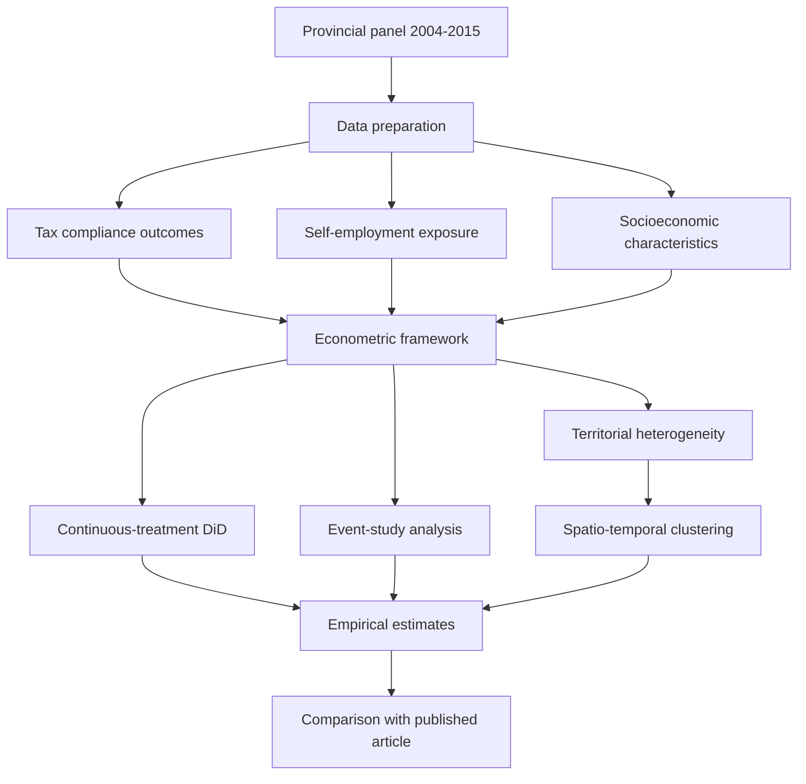

# Spatial Tax Reform Compliance — Replication Package

<p align="center">
  
</p>

*Spatial distribution of Italian provincial clusters and the evolution of self-employment income across territorial groups.*

Replication material accompanying the research article:

**Spatial consequences of tax reforms on tax compliance: econometric evidence from the Italian Minimum Taxpayer Regime**

**Authors:** Amedeo Argentiero, Paolo Maranzano, Gianluca Monturano, and Giulio Pedrini

**Published in:** *The Annals of Regional Science*, Volume 75, Article 147 (2026).

**Published article:** https://link.springer.com/article/10.1007/s00168-026-01546-y

**DOI:** https://doi.org/10.1007/s00168-026-01546-y

**GitHub repository:** https://github.com/gmonturano/tax_evation_self_employed

---

## Overview

This repository provides the main R code, supporting documentation, and simulated data associated with the empirical analysis presented in the paper.

The study investigates the spatial consequences of Italy's Minimum Taxpayer Regime (MTR), a preferential tax regime introduced in 2008 for self-employed individuals earning below an annual income threshold of €30,000.

The reform combined simplified administrative requirements with a proportional tax regime, potentially affecting taxpayers' incentives to report income, enter self-employment, and comply with fiscal obligations.

The empirical analysis examines whether the reform generated heterogeneous effects on tax compliance across Italian provinces, taking into account differences in income levels, occupational composition, and territorial characteristics.

The study combines counterfactual econometric methods with spatial and temporal analysis to investigate the differentiated responses of local economies to a nationwide tax intervention.

This repository provides the principal coding material associated with the empirical analysis rather than the complete collection of data-construction, exploratory, and supplementary estimation scripts.

Because part of the original empirical database is subject to confidentiality restrictions, the repository includes an explicitly simulated dataset for methodological illustration and code-consistency checks.

---

## Empirical framework

The empirical investigation focuses on the territorial consequences of the 2008 Minimum Taxpayer Regime and examines the relationship between tax reform, self-employment, and tax compliance.

The original empirical panel covers **103 Italian provinces over the period 2004–2015**.

The main methodological components include:

- **Difference-in-Differences (DiD):** exploiting the introduction of the tax reform to investigate changes in tax compliance associated with the policy intervention.
- **Continuous-treatment specifications:** accounting for heterogeneous exposure to the reform across provinces.
- **Two-Way Fixed Effects (TWFE):** controlling for unobserved time-invariant provincial characteristics and common temporal shocks.
- **Event-study analysis:** examining the temporal dynamics of the estimated relationships around the reform.
- **Territorial heterogeneity:** evaluating differences across geographical areas and socioeconomic groups.
- **Spatio-temporal clustering:** identifying groups of provinces characterized by similar territorial and temporal patterns.
- **Robustness analysis:** assessing the sensitivity of the estimates to alternative specifications and treatment definitions.

The research distinguishes two potential channels through which the reform may affect tax compliance.

### Intensive margin

The reform may influence the amount of income declared by existing self-employed taxpayers.

In particular, eligibility for preferential treatment below the €30,000 threshold may create incentives for taxpayers to adjust reported income.

### Extensive margin

The reform may also influence the proportion of individuals participating in self-employment.

Changes in occupational participation may affect the composition of the tax base and the incidence of tax non-compliance.

The empirical framework investigates the interaction between these mechanisms and their heterogeneous geographical implications.

The complete econometric specification, identification assumptions, and interpretation of the results are provided in the published article.

---

## Replication workflow



**Note:** The diagram describes the complete empirical framework presented in the article. The public repository provides the principal selected scripts and a separate simulated-data demonstration, not the complete confidential estimation environment.

---

## Repository structure

```text
Spatial-Tax-Reform-Compliance/
│
├── code/
│   ├── 00_simulated_workflow.R
│   └── 01_main_did_original.R
│
├── db/
│   └── simulated_panel.csv
│
├── cover.png
│
└── README.md
```

---

## Data availability

The empirical analysis combines several data sources, including information on self-employment, occupational characteristics, and provincial tax compliance.

The provincial-level tax evasion data used in the analysis were provided by the Italian Revenue Agency under a non-disclosure agreement with Prof. Bruno Chiarini (University of Naples Parthenope).

**These restricted administrative data cannot be publicly distributed.**

Consequently, the original confidential estimation panel is not included in this repository.

To facilitate methodological inspection, the repository provides an independently generated simulated dataset.

```text
db/simulated_panel.csv
```

The simulated dataset contains entirely artificial observations and does not reproduce the original confidential tax records.

It is intended exclusively to demonstrate the general structure of a continuous-treatment Difference-in-Differences workflow.

The synthetic data are not a sample of the restricted administrative database and should not be interpreted as representing actual Italian provincial tax compliance.

### Limitations of the simulated database

The simulated database is intended to support:

- Inspection of the general panel-data structure.
- Understanding of the treatment and post-reform interaction.
- Verification of basic econometric coding procedures.
- Demonstration of the Difference-in-Differences estimation logic.
- Basic checks of the simulated-data workflow.

The dataset does not reproduce the complete original variable structure, empirical distributions, treatment assignment, or spatial dependence contained in the confidential panel.

**Estimates obtained using the simulated data are illustrative and cannot reproduce the coefficients, standard errors, statistical significance, or substantive conclusions reported in the published paper.**

The article remains the authoritative reference for the original empirical findings.

---

## Main R scripts

### `code/00_simulated_workflow.R`

Provides a self-contained demonstration of the continuous-treatment Difference-in-Differences framework using the simulated panel dataset.

The script illustrates the construction of the post-reform indicator, the interaction between treatment exposure and the policy period, and the estimation of a basic regression model.

This script is intended for methodological demonstration and code-consistency checks.

It does not reproduce the complete empirical analysis of the published article.

### `code/01_main_did_original.R`

Contains the principal Difference-in-Differences estimation code selected from the authors' original working scripts.

The script implements continuous-treatment specifications and related robustness procedures associated with the empirical investigation.

The original estimation workflow relies on the confidential processed dataset and additional supporting information.

In particular, the script expects the original database:

```text
final_merged_dataset.RData
```

and the metadata workbook:

```text
meta_amedeo.xlsx
```

These files are not included in the public repository.

The original script may also contain file paths corresponding to the authors' local research environment.

Consequently, the original estimation script is provided to document the empirical specification logic and is not intended to run directly using the simulated dataset.

Full reproduction of the published estimates requires authorized access to the restricted data and the corresponding supporting materials.

---

## How to run

Download or clone the repository and open the project root directory in R or RStudio.

### Step 1 — Inspect the simulated database

The simulated data can be loaded using:

```r
db <- read.csv("db/simulated_panel.csv")
```

Inspect the dataset structure:

```r
str(db)
names(db)
summary(db)
```

### Step 2 — Execute the simulated workflow

From the project root:

```r
source("code/00_simulated_workflow.R")
```

This executes the publicly available illustrative estimation procedure.

The resulting coefficients should be interpreted exclusively as simulated-data outputs.

### Step 3 — Inspect the original estimation code

The main original Difference-in-Differences script is located at:

```text
code/01_main_did_original.R
```

The original script requires the confidential estimation data, the corresponding metadata workbook, and the necessary R packages.

It cannot be used to reproduce the published results with the synthetic dataset alone.

Authorized users with access to the complete research environment may adapt the original paths and supporting inputs to execute the full empirical workflow.

---

## Representative figure

The repository includes:

```text
cover.png
```

The figure combines two complementary graphical representations of territorial heterogeneity in the Italian economy.

### Spatial clustering

The first panel presents a geographical classification of Italian provinces into three clusters.

The map provides a visual representation of spatial heterogeneity across the national territory.

### Self-employment income dynamics

The second panel presents the evolution of self-employment income across the three territorial clusters.

The time-series representation highlights differences in the trajectories of self-employment income during the period covered by the empirical analysis.

Together, the panels illustrate the importance of geographical and socioeconomic heterogeneity in evaluating the effects of nationwide tax reforms.

The figure is included for descriptive and illustrative purposes and is not generated by the simulated-data demonstration.

---

## Software requirements

The empirical analysis was developed entirely in **R**.

The original estimation scripts rely on packages for:

- Data manipulation and transformation.
- Panel-data econometrics.
- Difference-in-Differences estimation.
- Fixed-effects regression.
- Spatial analysis and geographical visualization.
- Statistical reporting.
- Reading metadata and external datasets.
- Exporting regression results.

Users should install the required dependencies declared in the corresponding scripts.

The complete original estimation workflow has not been independently verified using only the publicly distributed repository files.

The simulated-data demonstration and the original empirical analysis should be considered separate computational workflows.

---

## Replication outputs

The complete empirical analysis described in the published article produces econometric evidence concerning the territorial consequences of the Minimum Taxpayer Regime.

Depending on the specification and the availability of the original restricted data, these analyses include:

- Difference-in-Differences estimates.
- Continuous-treatment effects.
- Event-study estimates.
- Heterogeneous treatment effects.
- Spatial and territorial comparisons.
- Robustness checks.
- Supplementary statistical outputs.

The publicly distributed simulated-data workflow provides only illustrative econometric results.

The repository does not redistribute the confidential original estimates as an independent administrative database.

For the interpretation of the empirical findings, readers should consult the published article.

---

## Reproducibility and confidentiality

The authors support transparent and reproducible empirical research while respecting the confidentiality conditions governing access to restricted administrative data.

The original provincial tax evasion database cannot be shared publicly because it is subject to a non-disclosure agreement.

The public replication material therefore combines:

- Selected original R estimation code.
- An explicitly simulated dataset.
- A reproducible illustrative workflow.
- Documentation of the main empirical methodology.

This approach allows researchers to inspect the core estimation logic without disclosing confidential administrative information.

The simulated results must not be interpreted as estimates of the actual effect of the tax reform.

---

## Additional code availability

This repository makes publicly available the **main R code associated with the empirical analysis**.

The full set of coding files, including additional preprocessing procedures, database construction routines, event-study specifications, spatial analyses, robustness checks, and supplementary implementation details, is available from the authors upon reasonable request.

Access to confidential administrative data remains subject to the applicable non-disclosure agreement and cannot be guaranteed through a request for additional code.

---

## Citation

If you use the code, empirical framework, or methodological material provided in this repository, please cite the associated research article:

Argentiero, A., Maranzano, P., Monturano, G., & Pedrini, G. (2026).

**Spatial consequences of tax reforms on tax compliance: econometric evidence from the Italian Minimum Taxpayer Regime.**

*The Annals of Regional Science*, 75, Article 147.

https://doi.org/10.1007/s00168-026-01546-y

---

## Published article

**Journal:** The Annals of Regional Science

**Publisher:** Springer Nature

**Publication year:** 2026

**Volume:** 75

**Article number:** 147

**Publication date:** 13 October 2026

**DOI:** 10.1007/s00168-026-01546-y

**Article:** https://link.springer.com/article/10.1007/s00168-026-01546-y
