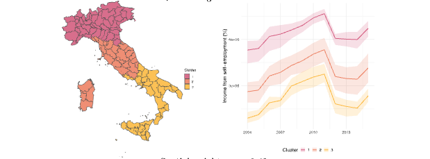
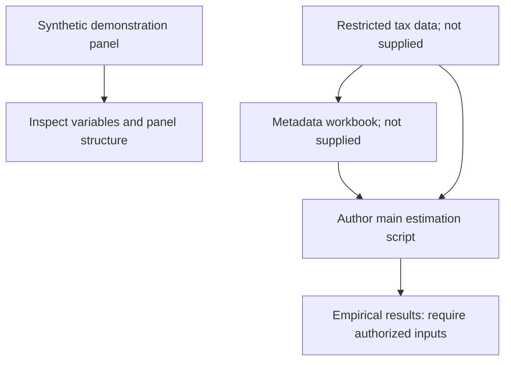

# Spatial consequences of tax reforms on tax compliance: econometric evidence from the Italian Minimum Taxpayer Regime — Replication Package



Replication materials associated with the paper:

**Spatial consequences of tax reforms on tax compliance: econometric evidence from the Italian Minimum Taxpayer Regime**

Paper repository: https://github.com/gmonturano/tax_evation_self_employed

## Overview

This repository documents the main empirical workflow presented in the paper. The public release focuses on the main source code, a processed or illustrative dataset, and a representative figure. Other working scripts and supplementary implementation details are not included in this release.

## Replication workflow



## Repository structure

```text
code/
  01_main_estimation.R
db/
  simulated_tax_evasion_panel.csv
cover.png
README.md
```

## Data

The empirical provincial-level tax evasion data were supplied by the Italian Revenue Agency under a non-disclosure agreement with Prof. Bruno Chiarini (University of Naples Parthenope) and **are not distributed** in this repository. `db/simulated_tax_evasion_panel.csv` is explicitly **synthetic**; its numbers are illustrative and cannot reproduce the article's estimates. The original main estimation script references the confidential dataset and `meta_amedeo.xlsx`. The latter is not supplied here. Therefore the distributed script is not executable end-to-end using the illustrative CSV without further adaptation and authorized inputs. Never interpret simulated estimates as empirical findings.

## Data availability

All scripts were developed by the authors using R. The provincial-level tax evasion data used in the analysis were provided by the Italian Revenue Agency under a non-disclosure agreement with Prof. Bruno Chiarini (University of Naples Parthenope) and therefore cannot be made public. For reproducibility, this repository provides the main source code and a synthetic dataset to illustrate the data layout. The restricted data and full empirical replication outputs cannot be recovered from the synthetic dataset.

## Main code and dependencies

- **Main script:** `code/01_main_estimation.R` (original author-provided script, not an independently reimplemented estimator).
- **Language:** R.
- **Execution:** run from the project root after updating any original absolute paths and providing auxiliary inputs explicitly required in the source.
- **Packages:** check the `library()` statements in the script and install the required R packages before running. Package versions and computational environment were not documented in the supplied material.

## How to run

From the repository root, in an R session:

```r
source("code/01_main_estimation.R")
```

**Important:** The original script contains local machine-specific paths and may call files that are not included here. Update these paths and supply the required metadata before running. The data included are for inspection, not a guarantee of successful end-to-end execution.

## Outputs and interpretation

The repository does not publish reconstructed regression tables as official estimates. The published paper remains the authoritative source for numerical results. The files supplied here have not been executed or validated against the article's tables in this environment.

## Additional code availability

The full set of coding files and additional implementation details are available from the authors upon reasonable request, subject to any confidentiality and data-sharing restrictions.

## Cover figure

The image at the top of this README is embedded using a relative path (`cover.png`). Keep this filename unchanged, or update the Markdown image reference if you rename the file.
