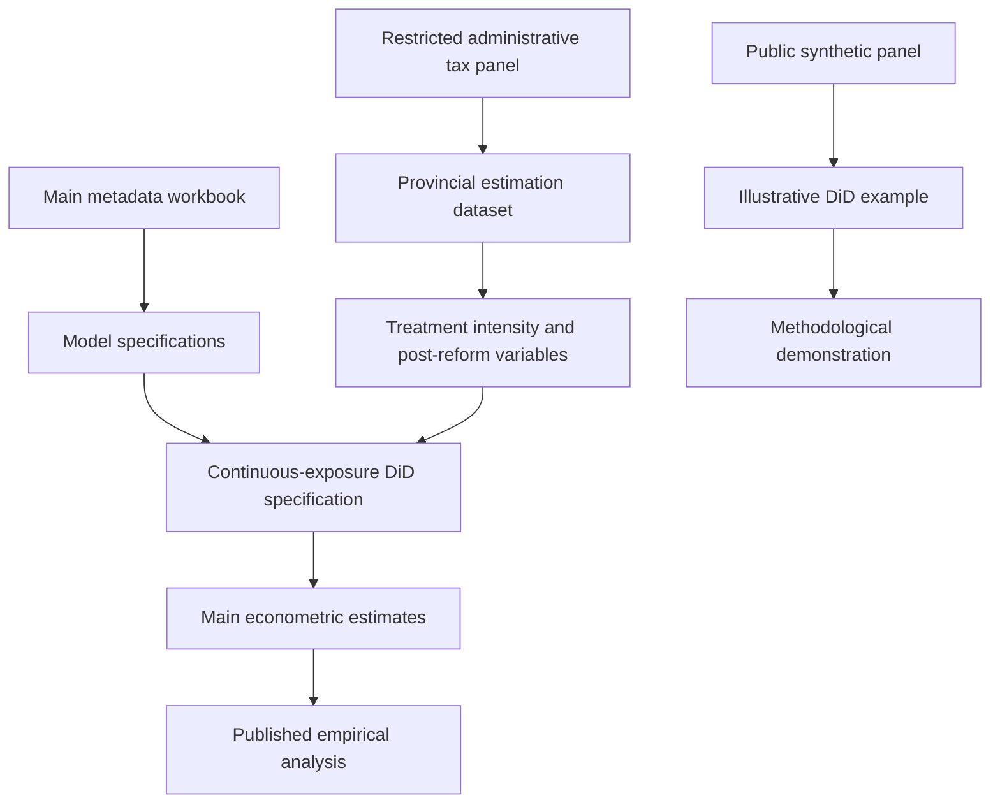

# Spatial Consequences of Tax Reforms on Tax Compliance — Replication Package

**Published in:** *The Annals of Regional Science* (Springer Nature), Volume 75, Issue 4, Article 147, 2026.

**DOI:** https://doi.org/10.1007/s00168-026-01546-y

**Published article:** https://link.springer.com/article/10.1007/s00168-026-01546-y

**Authors:** Amedeo Argentiero, Paolo Maranzano, Gianluca Monturano, Giulio Pedrini.

**Repository:** https://github.com/gmonturano/tax_evation_self_employed

---

<p align="center">
  
</p>

## About this replication package

This repository accompanies the research article:

**Spatial consequences of tax reforms on tax compliance: econometric evidence from the Italian Minimum Taxpayer Regime.**

This public repository focuses on the **main econometric estimation procedures** associated with the article. It is not the complete computational archive underlying the published study.

The original administrative tax data are subject to confidentiality and data-sharing restrictions and are therefore **not publicly distributed**.

A synthetic dataset and an illustrative estimation script are provided to demonstrate aspects of the empirical approach without disclosing confidential observations.

**The full replication package must be requested by contacting the corresponding author directly via email.** Any provision of original data remains subject to the applicable confidentiality agreements and authorization requirements.

---

## 1. Overview

The study investigates the spatial and temporal consequences of the Italian Minimum Taxpayer Regime on tax compliance.

The reform introduced in 2008 established a preferential tax regime for eligible self-employed taxpayers with earnings below a specified threshold.

The analysis examines whether the reform affected tax reporting behavior and whether its consequences differed across Italian provinces.

The empirical framework combines administrative tax information with territorial socioeconomic characteristics and self-employment indicators.

The principal estimation strategy is based on a Difference-in-Differences (DiD) framework incorporating heterogeneous exposure to the reform.

The published analysis also considers the territorial distribution of policy effects and the relevance of spatial heterogeneity.

The public repository is restricted to the principal estimation procedures and an independent synthetic demonstration.

---

## 2. Scope of public replication

The materials publicly available in this repository include:

- The main R estimation script for the confidential research panel.
- Supporting functions for metadata-driven estimation.
- The metadata workbook defining the main specifications.
- A synthetic provincial panel dataset.
- An illustrative DiD estimation using synthetic observations.
- Documentation of the research workflow.

The public repository is **not sufficient for exact reproduction of the published regression coefficients**.

The complete computational archive may additionally require:

- The original administrative estimation panel.
- Database construction and merging routines.
- Variable transformation procedures.
- Complete model specifications.
- Event-study analyses.
- Spatial and territorial heterogeneity procedures.
- Robustness and sensitivity analyses.

Access to the complete materials must be requested directly from the corresponding author.

Confidential administrative datasets cannot be redistributed without the necessary permissions.

---

## 3. Replication workflow



The synthetic-data branch is intended only for methodological illustration.

It does not reproduce the empirical findings of the published paper.

---

## 4. Repository structure

```text
tax_evation_self_employed/
│
├── code/
│   ├── 00_functions.R
│   ├── 01_main_estimation.R
│   ├── 02_synthetic_demo.R
│   └── meta_amedeo.xlsx
│
├── db/
│   └── simulated_panel.csv
│
├── cover.png
├── .gitignore
└── README.md
```

The restricted original estimation database is intentionally excluded.

---

## 5. Data availability

The empirical analysis draws on administrative tax information and socioeconomic data associated with Italian self-employment and provincial tax compliance.

The processed research panel includes variables related to:

- Tax compliance and the tax gap.
- Self-employment characteristics.
- Provincial economic conditions.
- Exposure to the tax reform.
- Relevant territorial controls.
- Time and provincial identifiers.

### 5.1 Confidential estimation dataset

The main estimation script expects the original processed research panel at:

```text
db/final_merged_dataset.RData
```

This file is **not distributed publicly**.

Its absence from the repository is intentional.

### 5.2 Synthetic sample dataset

The repository includes:

```text
db/simulated_panel.csv
```

This dataset contains artificially generated observations used to demonstrate the general structure of a panel DiD model.

It can be used to:

- Inspect an illustrative provincial panel structure.
- Examine the definition of treatment exposure.
- Demonstrate the construction of a post-reform interaction.
- Execute the separate synthetic estimation script.

**Synthetic data cannot be used to validate or reproduce the substantive results of the paper.**

They are not a substitute for the original confidential administrative observations.

---

## 6. Metadata and model specifications

The main estimation specifications are associated with:

```text
code/meta_amedeo.xlsx
```

The public estimation script uses the main specification information from the first worksheet.

The workbook supports the definition of the principal empirical models and their associated variables.

The analysis is based on a continuous-exposure Difference-in-Differences specification, conceptually represented by:

```text
Outcome_it =
    TreatmentExposure_i × Post_t
    + Controls_it
    + Province fixed effects
    + Time fixed effects
    + Error_it
```

This representation summarizes the estimation structure; the exact implemented variables and transformations are defined in the supplied R scripts and metadata.

The complete range of specifications reported in the paper may require additional computational materials.

---

## 7. Main R scripts

### `code/00_functions.R`

Provides supporting functions for loading the research panel and implementing metadata-driven specifications.

### `code/01_main_estimation.R`

Contains the main estimation procedure intended for the restricted research dataset.

The script expects the confidential provincial panel and the required variables used in the original analysis.

It does not silently substitute synthetic observations for the original administrative data.

### `code/02_synthetic_demo.R`

Provides a separate illustrative DiD estimation using the synthetic dataset.

The example demonstrates an estimation workflow but does not implement a numerical replication of the published results.

---

## 8. Software requirements

The analysis is implemented in **R**.

The scripts use packages for:

- Panel-data estimation.
- Data management.
- Excel metadata import.
- Regression analysis.
- Statistical inference.

Users should install the dependencies referenced in the individual scripts before execution.

RStudio is recommended but not required.

---

## 9. How to run

Clone the repository:

```bash
git clone https://github.com/gmonturano/tax_evation_self_employed.git
```

Open the repository root in R or RStudio.

### Synthetic demonstration

The public illustrative example can be executed using:

```r
source("code/02_synthetic_demo.R")
```

This analysis relies only on synthetic observations.

### Main estimation

With authorized access to the original research database, the main estimation script can be executed using:

```r
source("code/01_main_estimation.R")
```

The latter requires the restricted dataset at the expected location and all variables used by the original empirical specifications.

**The main estimation cannot be reproduced from the publicly distributed synthetic dataset alone.**

---

## 10. Replication outputs

Depending on the available data and specification, the scripts can generate:

- Regression coefficient estimates.
- Standard errors.
- Statistical significance measures.
- Model summaries.

The synthetic demonstration produces illustrative statistical estimates.

**These results must not be interpreted as published tax-compliance effects or as validation of the paper's empirical findings.**

The published article is the official reference for the substantive results and their interpretation.

---

## 11. Full replication package — available upon request

**This repository provides the publicly released main estimation procedures, rather than the complete replication archive.**

The complete replication package includes the broader computational materials associated with the empirical study, including data-construction routines, additional estimation procedures, and robustness analyses.

**Researchers wishing to obtain the full replication package should contact the corresponding author directly by email.**

When requesting the materials, please include:

- The article title or DOI.
- Your research affiliation.
- A brief description of the intended replication purpose.

Administrative tax records and other restricted materials may be provided only where legally permitted and specifically authorized.

**A request for the full replication package does not guarantee access to confidential underlying data.**

---

## 12. Citation

If you use the code or methodological materials, please cite:

Argentiero, A., Maranzano, P., Monturano, G., & Pedrini, G. (2026).

**Spatial consequences of tax reforms on tax compliance: econometric evidence from the Italian Minimum Taxpayer Regime.**

*The Annals of Regional Science, 75*(4), Article 147.

https://doi.org/10.1007/s00168-026-01546-y

### BibTeX

```bibtex
@article{argentiero2026tax,
  title   = {Spatial consequences of tax reforms on tax compliance:
             econometric evidence from the Italian Minimum Taxpayer Regime},
  author  = {Argentiero, Amedeo and
             Maranzano, Paolo and
             Monturano, Gianluca and
             Pedrini, Giulio},
  journal = {The Annals of Regional Science},
  volume  = {75},
  number  = {4},
  year    = {2026},
  doi     = {10.1007/s00168-026-01546-y},
  url     = {https://doi.org/10.1007/s00168-026-01546-y}
}
```

---

## 13. Contact and research inquiries

For questions about the estimation code or requests for the complete replication package, please contact the corresponding author directly by email.

**Repository scope:** Public main-estimation code and synthetic methodological illustration.

**Full replication package:** Available upon email request, subject to confidentiality and data-sharing restrictions.

**Official publication:** https://doi.org/10.1007/s00168-026-01546-y
