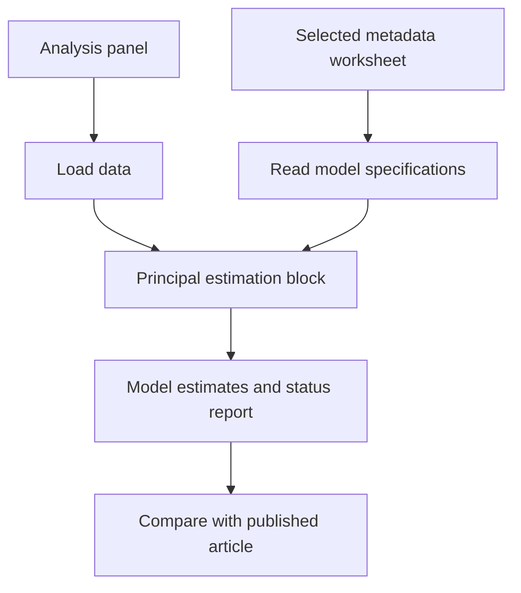

# Spatial Tax Reform Compliance — Replication Package

<p align="center">
  
</p>

Research article: **Spatial consequences of tax reforms on tax compliance: econometric evidence from the Italian Minimum Taxpayer Regime**

**Published article:** https://link.springer.com/article/10.1007/s00168-026-01546-y

**DOI:** https://doi.org/10.1007/s00168-026-01546-y

**Repository:** https://github.com/gmonturano/tax_evation_self_employed

## Overview

The project studies the spatial consequences of Italy’s Minimum Taxpayer Regime. The main specifications are represented by the first worksheet of the author-provided meta_amedeo workbook. The administrative panel used in the article cannot be published.

This repository provides the principal econometric source file, the metadata needed to identify the main specifications, the associated data material where redistribution is permitted, and a representative cover figure. Additional auxiliary scripts may be obtained from the authors on request.

## Main estimation design

**Continuous-exposure DID and TWFE specification metadata (DETREND (2)).** The selected worksheet is copied from the original author-provided metadata workbook. The original worksheet name is preserved. No robustness or auxiliary worksheet is included.

## Replication workflow



## Repository structure

```text
README.md
cover.png
code/
  00_functions.R
  01_main_estimation.R
  meta_amedeo.xlsx
  02_synthetic_demo.R
db/
  simulated_panel.csv
```

## Data and metadata

- **Database:** `db/simulated_panel.csv`. Illustrative simulated panel; original provincial tax-evasion data are restricted under a non-disclosure agreement.
- **Metadata:** `code/meta_amedeo.xlsx`, containing only the worksheet **DETREND (2)**.

The original administrative tax-evasion panel is subject to an NDA with the Italian Revenue Agency. `simulated_panel.csv` contains fully synthetic values and cannot reproduce published estimates. `01_main_estimation.R` requires an authorized copy of the original panel; `02_synthetic_demo.R` demonstrates only the estimation structure.

## Main R scripts

- `code/01_main_estimation.R`: principal documented estimation entry point.
- `code/00_functions.R`: shared metadata parsing, variable checks, estimation, and machine-readable export.
- `code/02_synthetic_demo.R`: separate DID example with artificial data, never a substitute for the published estimates.

## How to run

From the project root in R or RStudio, install the required R packages and execute:

```r
source("code/01_main_estimation.R")
```

For the self-contained demonstration (synthetic estimates only):

```r
source("code/02_synthetic_demo.R")
```

Dependencies: **readxl, plm** (plus base R).

## Outputs

When estimation is feasible, scripts write CSV outputs to `results/`. For metadata-based TWFE models, an accompanying `model_status.csv` indicates which specifications were estimated and which could not be run using the supplied inputs.

Published coefficients and standard errors are documented in the article; they are not guaranteed to be reconstructed from public demonstration inputs.

## Figure

`cover.png` is the representative illustration supplied for this paper. It is displayed at the beginning of this README using a repository-relative path.

## Code availability

The main publicly shareable source files are included here. **The full set of coding files and supplementary implementation details is available from the authors upon reasonable request**, subject to applicable confidentiality and data-sharing restrictions.

## Citation

Please cite the published article when using these materials:

**Spatial consequences of tax reforms on tax compliance: econometric evidence from the Italian Minimum Taxpayer Regime**. https://doi.org/10.1007/s00168-026-01546-y
