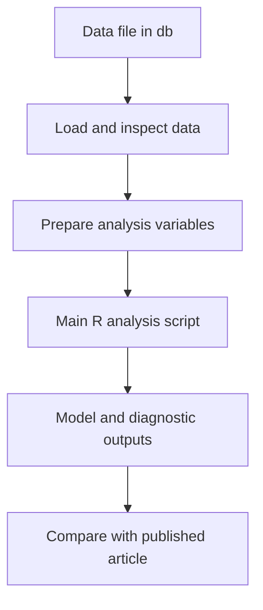

# Spatial Tax Reform Compliance — Replication Package

<p align="center">
  
</p>

*a spatial cluster map of Italy alongside the self-employment income trend by cluster*

Research article: **Spatial consequences of tax reforms on tax compliance: econometric evidence from the Italian Minimum Taxpayer Regime**

Repository: https://github.com/gmonturano/tax_evation_self_employed

## Overview

The paper examines how a tax reform relates to spatial heterogeneity in compliance and self-employment outcomes. The cover juxtaposes the provincial clustering map and the time-series trajectories of self-employment income by cluster.

This repository publishes the principal R material available for the empirical workflow, accompanying data material, and a representative figure. It does not include the complete collection of data-construction and exploratory scripts.

## Empirical approach

The core author script implements continuous-exposure Difference-in-Differences robustness specifications. An explicitly simulated panel is supplied to permit an independent code-consistency check without disclosing restricted tax data.

## Replication workflow



## Repository structure

```text
Spatial-Tax-Reform-Compliance/
  README.md
  cover.png
  code/
    00_simulated_workflow.R
    01_main_did_original.R
  db/
    simulated_panel.csv
```

## Data and availability

Provincial tax-evasion information was provided under a non-disclosure agreement with Prof. Bruno Chiarini (University of Naples Parthenope) and **is not distributed here**. `db/simulated_panel.csv` contains **entirely artificial values**, generated for illustration; it is not a sample of the restricted data.

The synthetic dataset does **not** replicate the complete set of original variables or identify the published effect. `code/01_main_did_original.R` requires restricted original data and `meta_amedeo.xlsx`, which are not publicly included.

## Main scripts and instructions

For a fully self-contained demonstration of a continuous-treatment DID structure, run:

```r
source("code/00_simulated_workflow.R")
```

The separate `code/01_main_did_original.R` is the original DID code as supplied in the working archive. It is provided for inspection of the author’s specification logic and is not runnable with the synthetic demonstration dataset. To use it for full replication, the appropriately authorized analyst must have the original restricted panel and metadata.

## Representative figure

`cover.png` shows a spatial cluster map of Italy alongside the self-employment income trend by cluster. The figure is provided for visual orientation; the original figure files are not needed to execute the statistical code.

## Software and reproducibility

The empirical code uses **R**. Install the packages referenced at the top of each script. The scripts were collected from the authors' working archives; their execution against the shared data files has **not been fully verified** in this release. Source files requiring external metadata, shapefiles, or complete input panels cannot be expected to run from this repository alone.

The article is the authoritative source for reported estimates, confidence intervals, and interpretations. Reduced or simulated databases should not be used to reproduce published numerical results.

## Additional code availability

The full set of coding files and further implementation details are available from the authors upon reasonable request, **subject to applicable confidentiality and data-sharing restrictions**.

